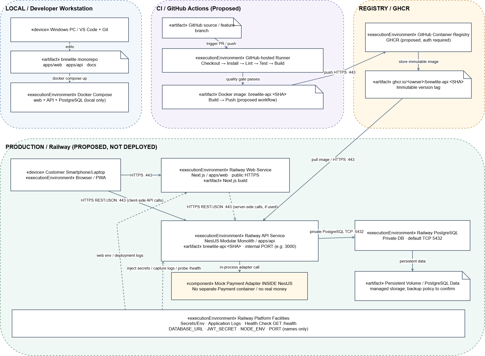

# A2 – Task 3.2: BrewLite Deployment Design

**Architecture baseline:** [Task 3.1](architecture/architecture.md), ADR-001–006 (đều Proposed).  
**Diagram source:** [deployment.puml](architecture/deployment.puml).

> Ảnh PNG đính kèm là bản preview dựng từ cùng mô hình; cần mở file Draw.io và **Export as PNG** đè ảnh trước khi nộp để xác nhận bản kết xuất chính thức từ Draw.io. Ký hiệu `«device»`, `«executionEnvironment»`, `«artifact»` chỉ ra vai trò UML tương ứng. Các kết nối trong file nguồn biểu diễn đầy đủ hơn bản preview.

## 1. Đối chiếu nền tảng và phương án triển khai

Task 3.1 chưa xác nhận nhà cung cấp production. Đề bài cho phép Render, Railway, Fly.io, Azure, AWS, VPS hoặc tương đương. Bản này **đề xuất Railway cho Next.js, NestJS và PostgreSQL; GHCR cho API image; GitHub Actions cho CI/CD**. Không mô tả đây là nền tảng đã được nhóm chọn hoặc đã deploy. Cần nhóm duyệt, thử thực tế và kiểm tra chi phí tại ngày sử dụng. Railway có tài liệu về Docker image từ GHCR, PostgreSQL/Volumes và định giá tính theo tài nguyên; Render có dịch vụ web, managed Postgres và lưu trữ bền vững; cả hai là phương án khả thi nhưng không suy ra miễn phí vô điều kiện.

| Phương án | Ưu điểm phù hợp BrewLite | Điều cần xác minh |
|---|---|---|
| Railway + GHCR (đề xuất) | Dễ gom Web/API/DB; nhận image từ GHCR; env, logs và private connectivity theo cấu hình dịch vụ | Quyền đọc image private, chi phí CPU/RAM/network/storage, hạn mức plan, network và health check thực tế |
| Render | Web service và managed PostgreSQL; hỗ trợ health checks; có thể cấu hình nguồn image | Cách deploy image, tier/chi phí, private DB URL, giới hạn sản phẩm/tài nguyên |
| Vercel + Render | Next.js có host riêng, API + DB tách biệt | Hai bên vận hành, CORS/cookie/cross-origin, secrets và chi phí; làm registry/deploy API nhất quán |

Tham khảo chính thức: [Railway services](https://docs.railway.com/services), [Railway pricing](https://docs.railway.com/pricing/plans), [Render deployment](https://render.com/docs/deploys), [Render pricing](https://render.com/pricing).

## 2. UML nodes, execution environments và artifacts

| Boundary/Node | Execution environment / Artifact | Vai trò |
|---|---|---|
| Local – Developer Workstation | Windows, VS Code, Git; artifact `brewlite` monorepo; Docker Compose dự kiến | Phát triển và chạy stack local; không là production |
| CI – GitHub Actions runner | Checkout, install, lint, test, build, Docker build | Quality gate và tạo artifact theo commit SHA; mới thiết kế |
| Registry – GitHub Container Registry | `ghcr.io/<owner>/brewlite-api:<SHA>` (đường dẫn mẫu) | Lưu immutable API image; không chứa database data |
| Production – Railway Web Service | `apps/web` – Next.js/PWA build | Phục vụ web qua public HTTPS; có thể build từ source. **Không giả vờ Web image được push GHCR khi chưa chọn luồng đó.** |
| Production – Railway API Service | Một NestJS Modular Monolith; image từ GHCR; module Auth/Product/Order/Payment/Promotion/Loyalty | Một ứng dụng Backend, không phải sáu microservices |
| NestJS API – internal component | Mock Payment Adapter | Chạy cùng API, không có container thanh toán riêng; không xử lý tiền thật |
| Production – Railway PostgreSQL | PostgreSQL và persistent storage được quản lý | Dữ liệu User, Product, Order, OrderItem, Payment, Promotion, LoyaltyTransaction; không public trực tiếp |
| Platform facilities | Env/secrets, runtime logs, health probe | Inject biến cấu hình, thu log và kiểm tra sức khỏe ứng dụng |

**Giới hạn:** Tên service, image path, hostname public, internal PORT và secrets trên hình đều mang tính đề xuất. Cần cập nhật theo dashboard và commit thực tế trước khi gọi bản vẽ là *As deployed*.

## 3. Connection paths và ports

| Origin → destination | Giao thức/port | Điều kiện |
|---|---|---|
| Customer Browser/PWA → Next.js | HTTPS public :443 | Tên miền production sau deploy |
| Browser → NestJS | HTTPS/REST JSON public :443 | Khi frontend client gọi API; kiểm tra CORS/JWT/cookie thực tế |
| Next.js Server → NestJS | HTTPS/REST JSON :443 | Chỉ áp dụng cho server-side fetch nếu nhóm triển khai |
| NestJS → PostgreSQL | PostgreSQL protocol private TCP :5432 mặc định | Lấy URL từ secret, không expose DB trực tiếp |
| GitHub Actions → GHCR | HTTPS :443 | Push image API sau quality gate và xác thực registry |
| Railway API → GHCR | Pull image qua registry HTTPS :443 | Cần quyền đọc image và trigger deploy được cấu hình |
| API → Mock Payment | In-process adapter call | Không tạo network service giả |
| Platform → API | `GET /health` qua service port nội bộ | Endpoint phải được lập trình và cấu hình probe ở Sprint sau |

Không giả định Next.js bắt buộc là proxy cho mọi API request; hai đường Browser→API và Next.js Server→API là hai khả năng có nhãn điều kiện. API lắng nghe `PORT` do nền tảng cấp, ví dụ 3000 chỉ là ví dụ, không được hardcode như deployment đã xác minh.

## 4. Secrets, database, migration và observability

- **API:** `DATABASE_URL`, `JWT_SECRET`, `NODE_ENV`, `PORT`, mock payment config nếu dùng; biến ở platform secrets/environment, `.env.example` chỉ giữ tên/mẫu không nhạy cảm.
- **Web:** API public base URL và cấu hình frontend không nhạy cảm; không đặt `DATABASE_URL`/`JWT_SECRET` trong các biến public `NEXT_PUBLIC_*`.
- **Persistent storage:** Dữ liệu nằm tại storage bền vững gắn với PostgreSQL/managed datastore, không nằm trong filesystem tạm của API/web. Cần kiểm tra backup/retention thực tế.
- **Migration:** Chạy migration có kiểm soát trước khi chuyển traffic hoặc trong release step được duyệt; thử trên test DB, có backup và kế hoạch khôi phục. Không chạy nhiều replica migration đồng thời.
- **Health:** Thiết kế `GET /health`; xác minh process và DB readiness theo chính sách. Chưa khẳng định endpoint đang có trong code.
- **Logging:** NestJS ghi structured logs ra stdout/stderr; dashboard platform thu nhận và hiển thị; không log token, mật khẩu, credentials hoặc raw secrets.
- **CI/CD:** Dự kiến checkout → install → lint → unit/integration test → build → Docker image tagged SHA → push GHCR → deploy → migration an toàn → health/smoke test; dừng và rollback khi lỗi theo Task 5.

## 5. Traceability: deployment → architecture → code/config

| Deployment element | Task 3.1 component | Source/config target | Trạng thái kiểm chứng |
|---|---|---|---|
| Next.js Web | Presentation layer | `apps/web` | Thư mục trong cấu trúc repository; runtime/deploy chưa xác minh |
| NestJS API | Modular Monolith API/domain | `apps/api` | Thư mục trong cấu trúc repository; module/source chưa xác minh |
| Mock Payment Adapter | ADR-004/Payment infrastructure | dự kiến `apps/api/src/payments/` | Thiết kế, chưa xác minh hiện thực |
| PostgreSQL | Data access, ADR-003 | `docker-compose.yml`, migration dự kiến trong `apps/api` | Cần kiểm tra code, managed DB chưa deploy |
| Local Compose | Local testing | `docker-compose.yml` | Có tên file trong cấu trúc repo; nội dung/chạy thành công chưa xác minh |
| CI runner | CI/CD design | `.github/workflows/` | Có thư mục; pipeline thành công chưa xác minh |
| GHCR image | Container artifact | Dockerfile API, GitHub Actions workflow | Chưa triển khai/cần tạo ở Task 4–5 |
| Railway services | Deployment runtime | Platform dashboard/settings, deployment config | Chưa chốt/chưa triển khai |
| Secrets | ADR-006 configuration | `.env.example`, platform secret settings | Chưa kiểm chứng settings thật |
| Health/logs | ADR-006 observability | `apps/api` health/logging and platform config | Chưa kiểm chứng endpoint/logging thật |

Việc có tên thư mục **không chứng minh chức năng đã chạy**. Sau Task 4–5, cập nhật bảng bằng commit path, workflow run và URL production thật. Đối chiếu Activity/Sequence/Class Diagram đã nhóm duyệt (hiện chưa có bản đầy đủ để xác minh): một monolith API, không gọi DB từ browser, nhất quán trạng thái Order/Payment và thời điểm transaction/tồn kho.
